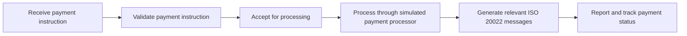

# GlobalPay Payment Flow

## Approved High-Level Lifecycle

The following conceptual lifecycle is approved for GlobalPay:

1. **Receive payment instruction.** GlobalPay receives a cross-border payment instruction.
2. **Validate payment instruction.** The instruction is checked; the validation rules are not defined here.
3. **Accept for processing.** An instruction is accepted for processing. The conditions for acceptance remain undecided.
4. **Process payment.** The simulated payment processor handles the payment flow. It does not move real funds or connect to a real banking network.
5. **Generate ISO 20022 messages.** Relevant ISO 20022 messages are generated as part of the simulated flow.
6. **Report and track status.** Payment status is reported and can be tracked. Specific statuses and transitions are not defined here.

This document describes the lifecycle at a high level only. It does not prescribe detailed business rules, status values, message ordering, or implementation details.

## Open Questions

- What instruction fields and validation rules are required?
- What conditions determine whether an instruction is accepted for processing?
- Which payment statuses, transitions, and processing outcomes should be supported?
- Which ISO 20022 message types and versions should be generated, and when?
- What detailed processing behavior should the simulated processor demonstrate?
